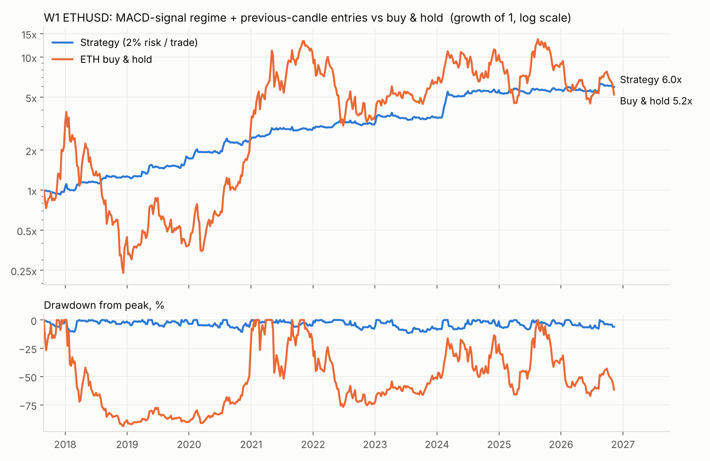

# W1 ETHUSD — MACD regime + previous-candle entries

Backtest of a weekly ETHUSD strategy: the slow MACD line gives the direction, the previous
weekly candle gives the entry and the stop. Simulated on 1h Bitstamp bars, Aug 2017 → Nov 2026.



## Rules (long side — shorts are the exact mirror)

| | |
|---|---|
| **Regime** | W1 MACD(12,26,9) **signal line** rising on the last closed week → longs only; falling → shorts only |
| **Setup A** | previous weekly candle closed up → buy the open of the new week |
| **Setup B** | previous candle closed down → buy-stop at `PrevOpen + (PrevHigh − PrevOpen) / 2` |
| **Stop** | 0.1% below the previous candle's low (alternative: middle of its lower wick) |
| **Roll** | every new week the stop moves under the new previous candle; if the new week has no setup A the position is closed at the open (it can come back through B) |
| **Regime flip** | close at the weekly open |
| **Re-entries** | none inside the week — the next weekly setup *is* the re-entry (see below) |
| **Sizing** | risk 2% of equity between entry and stop, leverage capped at 3x |
| **Costs** | 5 bps per side; funding / borrow not modelled |

Weeks start Monday 00:00 UTC. If a 1h bar touches both an entry trigger and the stop, the stop is assumed hit.

## Results (base rules, 5 bps per side)

| | Strategy | ETH buy & hold |
|---|---|---|
| Growth of 1 | 6.2x | 5.3x |
| CAGR | 21.9% | 19.8% |
| Max drawdown (weekly closes / 1h worst price) | −11.3% / −14.3% | −93.8% |
| Sharpe (weekly) | 1.22 | 0.64 |
| Trades / win rate / avg R | 153 / 42% / +0.67R | — |

Average position is only 0.25x equity (max 1.37x), in the market 58% of the time — the small drawdown is
mostly small size. Buy & hold at the same volatility (20% of equity in ETH): 2.4x, −36%.

## Audit (`audit.py` → `results/audit.txt`)

**No lookahead found.** The regime of week *t* is `signal[t-1] > signal[t-2]` (closed weeks only). Re-running on data
truncated at five dates reproduces every earlier trade exactly. Binance ETHUSDT gives the same result (6.5x, 0.99 correlation).

**Execution is not the weak point.** 30 bps costs: 5.1x. Entry 24h late: 5.1x. Stops slipping 1%: 5.0x.
10 bps + 4h late + 0.5% stop slip + 10%/yr long carry together: 4.7x.

**Why the ETH number is still too good:**

- **ETH is the best of 8 coins.** Same rules untouched on BTC, BNB, XRP, LTC, ADA, SOL, DOGE: all positive, but Sharpe
  0.26–0.97 (median ~0.8) vs 1.26 for ETH. BTC: 2.8x vs 7.5x for holding.
- **No edge since 2025.** Average R in 2025–26 is between −0.06 and +0.23 on all 8 coins.
- **Ten trades make the result.** Median trade is −0.12R; without the 10 best trades (of 153) the average falls from
  +0.67R to +0.09R. Only 38% of weeks are positive. Bootstrap 95% CI of average R: [+0.27, +1.15].
- **Part of it is ETH, not MACD.** Candle rules with a time-shifted (placebo) regime still make 2.75x median; always-long makes 4.9x.
  The real MACD regime beats 99% of placebos, so the filter is real, but it explains roughly half of the result.
- **Selection.** The base was picked after seeing 24 non-martingale variants (median 5.4x, Sharpe 1.07, drawdown −17%).
- **Not modelled:** short borrow/funding, exchange risk, taxes. Longest stretch below an equity high: 43 weeks.

Realistic expectation: Sharpe around 0.7–0.8, not 1.2, with long flat periods.

## Re-entries

| Design | Result |
|---|---|
| Reclaim of the week's entry level, same stop | break-even (22 trades, +0.2R in total); long side +6.1R, short side −5.9R |
| "Spring": reclaim of the broken stop level, stop under the new low | loses money with the low stop; inconsistent with the half-wick stop |

Neither adds anything reliable, so the base uses none.

## Martingale

Doubling risk after a loss (max 4x): 36x with −28% drawdown. Plain 5% fixed risk: 51x with −26%.
Martingale is dominated by simply risking more.

## Timeframes, martingale, BTC+ETH+SOL (`mtf.py`, `mtf_diag.py` → `results/mtf.txt`, `results/mtf_diag.txt`)

Same rules on Binance 1h data, 5 bps per side, 2% risk per trade, from May 2018 (SOL from 2020–21).

| Timeframe | Sharpe BTC / ETH / SOL | Avg trade net (R) | Verdict |
|---|---|---|---|
| MN | 0.77 / 0.51 / 0.00 | +1.04 / +0.98 / −0.01 | 14–33 trades per coin, not significant |
| W1 | 0.89 / 1.33 / 0.98 | +0.40 / +0.70 / +0.41 | the only timeframe that holds on all three |
| D1 | 0.43 / 0.66 / 0.86 | +0.08 / +0.10 / +0.12 | thin edge, drawdowns −36% to −59% |
| H4 | −2.4 / −0.7 / −1.2 | −0.13 / −0.04 / −0.06 | no edge before costs, account wiped out |

Costs eat 0.01–0.02R per trade on W1, 0.03–0.05R on D1 and 0.06–0.12R on H4. H4 is simulated on only four 1h bars per candle.

**Martingale "recover"** (risk = base + all unrecovered losses, capped at 4x base): on W1 it matches plain fixed risk of the
same average size (Sharpe 0.83 vs 0.87 BTC, 1.42 vs 1.39 ETH, 0.99 vs 1.00 SOL) and sits at the cap for 28–69% of trades.
On D1 it loses 89–98% of the account at the worst point; with a 16x cap D1 goes to zero on all three coins.

**Combo on W1**, each coin risking 2% of a shared account: BTC+ETH+SOL from Apr 2021 Sharpe 1.04 (solo 0.27 / 1.16 / 0.98),
BTC+ETH from May 2018 Sharpe 1.30 (solo 0.89 / 1.33). Strategy returns correlate about 0.47, so the combo does not beat the
best coin but removes the risk of holding only the worst one.

## W1 regime + D1 entries (`w1d1.py` → `results/w1d1.txt`)

Direction from the weekly MACD signal line (last closed week), candle rules on daily bars. 2% risk, 5 bps per side.

| System | Median Sharpe, 8 coins | Median avg trade (R) | Median max drawdown |
|---|---|---|---|
| W1 regime + W1 entries | 0.88 | +0.47 | −20% |
| W1 regime + D1 entries | 0.65 | +0.11 | −62% |
| D1 regime + D1 entries | 0.54 | +0.08 | −56% |

- The weekly regime improves daily entries on 6 of 8 coins (worse on ADA and DOGE, negative on XRP), but stays below pure weekly.
- BTC / ETH / SOL Sharpe: 0.58 / 1.15 / 1.03, against 0.89 / 1.33 / 0.98 for pure weekly.
- Fragile to execution: at 10 bps BTC falls to Sharpe 0.25; with stops slipping 0.25% BTC is 0.06 and loses money.
- Placebo regimes beat the real one in 8% (BTC), 2% (ETH), 8% (SOL) of runs.
- BTC+ETH+SOL combo from Apr 2021: Sharpe 0.76, drawdown −78% (pure weekly: 1.04, −32%).

## Hold / breakeven / take-profit / pyramiding on W1 ETH (`hold.py`, `run_hold.py`, `hold_xcheck.py` → `results/hold_*.txt`)

Position held while the regime is intact, stop left at its initial level. Binance ETH from May 2018, 2% risk per leg, 5 bps.
Reference = previous base (stop re-set under each new candle, exit when a week has no setup A): 6.0x, −15%, Sharpe 1.33.

| Variant | Growth | Max drawdown | Sharpe |
|---|---|---|---|
| Hold, nothing else | 3.0x | −32% | 0.80 |
| Hold + breakeven after +1R | 3.8x | −32% | 0.95 |
| Hold + breakeven +1R + take-profit 20% | 3.9x | −14% | 1.41 |
| Hold, pyramid up to 3 legs | 15.5x | −54% | 0.95 |
| Hold, single leg at 6% risk (same average leverage) | 15.1x | −49% | 0.95 |

- Plain holding is worse than the reference: the fixed stop gives back open profit until the MACD flips.
- Take-profit 20% is a spike, not a plateau: 10% gives Sharpe 0.68, 30% gives 1.13. On 8 coins its median Sharpe is 0.62 vs 0.87 for the reference.
- Pyramiding equals a single position with the same average leverage.
- Across 8 coins no hold variant beats the reference on median Sharpe (best 0.74).

### Same study on D1 and H4 (`results/hold_ETH_D1.txt`, `hold_ETH_H4.txt`, `hold_xcheck_D1.txt`, `hold_xcheck_H4.txt`)

Median Sharpe over 8 coins, 2% risk per leg, 5 bps:

| Variant | W1 | D1 | H4 |
|---|---|---|---|
| Reference (previous base) | 0.87 | 0.57 | −1.63 |
| Hold | 0.65 | 0.67 | 0.20 |
| Hold + breakeven +1R | 0.72 | 0.70 | −0.16 |
| Best take-profit level tested | 0.69 (30%) | 0.57 (30%) | −0.17 (10%) |
| Hold, up to 3 legs | 0.74 | 0.81 | 0.04 |
| Hold, single leg at 6% risk | 0.67 | 0.68 | 0.17 |

- D1: holding beats the D1 base slightly (fewer trades, fewer costs) but drawdowns stay around −50%; every take-profit level lowers Sharpe.
- D1 pyramiding: higher median Sharpe than one leg at triple risk (0.81 vs 0.68), with −81% median drawdown at 2% per leg.
- H4: holding stops the account being wiped out by costs, but median Sharpe is 0.20 with −94% drawdown; tight take-profits (1–3%) lose everything.

## Recovery time: martingale vs fixed risk, W1 (`recovery.py` → `results/recovery.txt`)

Base rules, 8 coins, medians. "Underwater" = below the previous equity high.

| Sizing | Max drawdown | Longest underwater | Avg trades to a new high | Worst case, trades |
|---|---|---|---|---|
| Fixed 2% | −20% | 934 days | 9.9 | 39 |
| Fixed, same average risk as the martingale | −49% | 936 days | 10.0 | 46 |
| Martingale recover (cap 4x) | −56% | 822 days | 6.5 | 27 |
| Martingale double (max 4x) | −46% | 752 days | 8.0 | 31 |
| Martingale recover (cap 8x) | −64% | 520 days | 5.3 | 19 |

- Martingale gets back to a new high in fewer trades on 8 of 8 coins (recover) and 6 of 8 (double).
- Fixed risk recovers at the same speed whatever its size; only the depth changes.
- ETH, the 16 drawdowns of 60+ days: median recovery 153 days fixed, 73 days recover, 101 days double. Recover was clearly faster in 5, the same in 10, slower in 1 (270 → 298 days), and deeper than fixed 2% in 14.

## Files

- `fetch_data.py` — downloads data (Bitstamp 1h; Coinbase 1d only to warm up the MACD)
- `backtest.py` — engine and `Cfg` with every switch
- `run_grid.py` — grid, re-entry designs, robustness → `results/`
- `audit.py` — lookahead, stress, placebo, second venue, other coins → `results/audit.txt`
- `mtf.py`, `mtf_diag.py` — MN/W1/D1/H4, martingale modes, BTC+ETH+SOL combo
- `w1d1.py` — weekly regime with daily entries
- `hold.py`, `run_hold.py`, `hold_xcheck.py` — hold / breakeven / take-profit / pyramiding
- `recovery.py` — time underwater, martingale vs fixed risk
- `eth_martingale.py` — ETH W1 fixed-stake statistics for the 4x-capped martingale → `results/eth_martingale.txt`
- `combine.py` — perp strategy + weekly 5% OTM option momentum (from GridOfSellCallsETH) on one account → `results/combined.txt`, `results/combined.png`
- `plot.py` — chart

```bash
python fetch_data.py && python run_grid.py && python plot.py
```

Backtest only: one asset, ~9 years, 153 trades. Not financial advice.
